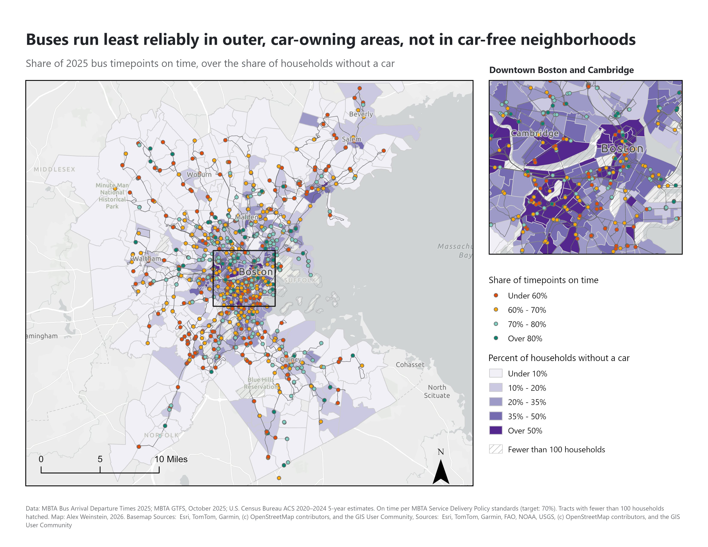
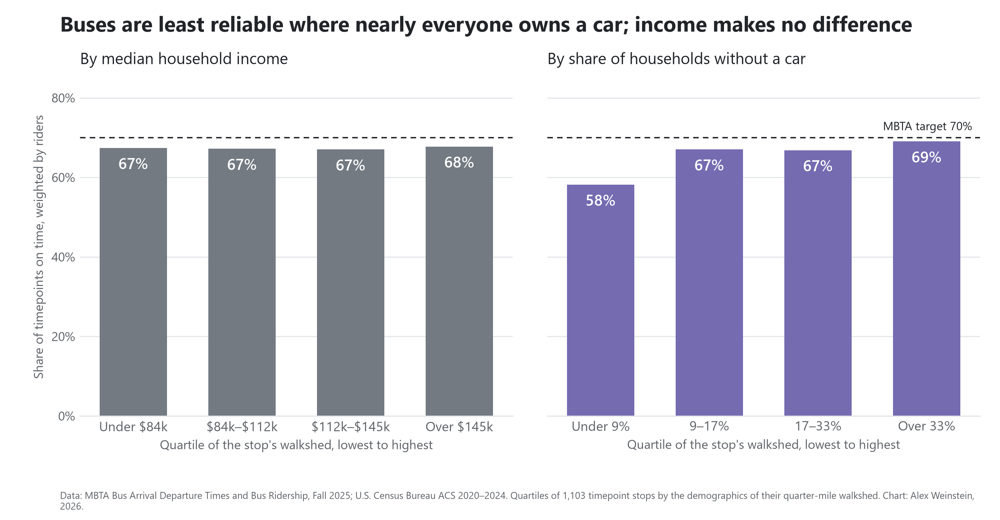
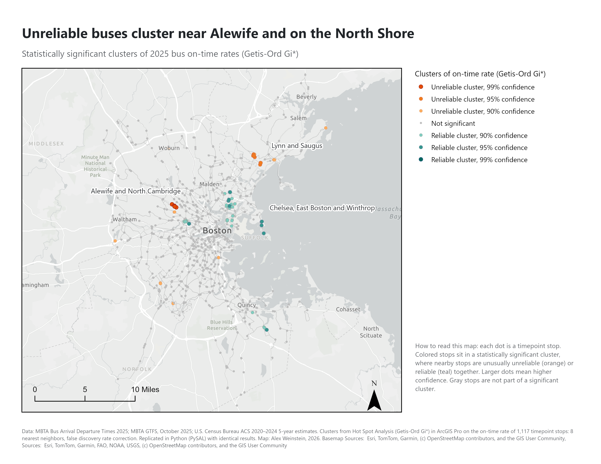

# MBTA Bus Reliability and Equity

An analysis of every MBTA bus timepoint in 2025, testing whether buses serving lower income and car-free neighborhoods run less reliably than buses serving wealthier, car-owning areas.



*Map made in ArcGIS Pro. [PDF version](figures/map_bus_reliability.pdf)*

## The question

**Do MBTA buses serving lower income, lower car ownership neighborhoods run less reliably than buses serving wealthier areas?**

**Hypothesis going in:** yes. Neighborhoods with lower incomes and more car-free households would see worse on-time performance, even though riders there depend on the bus most.

**Why it matters:** about a third of households in Suffolk County (Boston, Chelsea, Revere and Winthrop) don't own a car. For them, an unreliable bus means missed shifts, longer trips and fewer options.

## What I found

The hypothesis was **not supported**. Reliability problems follow geography more than demographics.

1. **Reliability is low across the whole network.** Buses were on time at **69.8%** of timepoints in 2025, right at the MBTA's 70% minimum. **92 of 148 routes** fell below that target, carrying about **35% of weekday riders** (115,000 of 327,000 boardings).
2. **Income makes no difference.** Weighted by riders, on-time performance is between **67% and 68% in every income quartile**, and income has no significant effect in any model.
3. **Car-free neighborhoods get better reliability, not worse.** Weighted by riders, buses in the most car-free quarter of neighborhoods were on time **69%** of the time, against **58%** in the least car-free quarter.
4. **That advantage comes from location.** Car-free neighborhoods are close to downtown, where routes are short and frequent. Comparing stops at a similar distance from downtown, more car-free households go with *slightly lower* reliability, about 1 to 1.5 points per 10 points of car-free share. This holds only once location is accounted for.
5. **Unreliability is mostly route by route, not regional.** Only **8% of stops** sit in a statistically significant cluster of good or poor reliability. Whether a stop is reliable depends mostly on the routes that serve it, not the area around it.
6. **The worst clusters are Lynn and Alewife, for different reasons.** Around **Lynn and Saugus** (12 stops, 53% on time) the routes themselves perform poorly all year: **455** (51%), **426** (59%) and **450** (55%). It's a lower-income area ($85k median income vs $112k), making it the clearest equity case in the data, and an exception to income making no difference network-wide. Around **Alewife** (11 stops, 51% on time), 45% of scored crossings are departures from the terminal, which face the MBTA's strictest test, so part of that cluster reflects how buses are scored.
7. **How the MBTA measures reliability shapes where problems show up.** Frequent routes are judged by a lenient spacing test, and frequent-test stops score about 10 points higher (74% vs 63%). First-stop departures face the strictest test: 0 to 3 minutes late, never early. The most reliable cluster, **Chelsea, East Boston and Winthrop** (36 stops, 77% on time), runs on the network's strongest routes, **111** (82%) and **SL3** (78%), but 68% of its crossings are judged by the lenient test, against 23% network-wide.

**In short:** unreliable service concentrates on specific routes and terminals in the outer network, most clearly in Lynn, rather than in car-free or lower-income neighborhoods overall. Car-free riders benefit from living near the core, though among places at a similar distance from downtown they fare slightly worse, and part of the core's advantage comes from how the MBTA measures reliability.

### On-time rate by neighborhood (Fall 2025, weighted by riders)



Source: `results/reliability_by_quartile.csv`

### How the car-free result depends on location

Stop-level OLS with robust standard errors (`results/carfree_sensitivity.csv`). Each row adds controls; effects are in points of on-time rate.

| Model | Car-free effect, per 10 points | p | Income effect, per $10k | p |
|---|---|---|---|---|
| No controls | +0.6 | 0.005 | | |
| + income | +0.8 | 0.002 | +0.1 | 0.13 |
| + distance to downtown | −0.9 | 0.007 | 0.0 | 0.63 |
| + on-time test type only | −0.3 | 0.17 | +0.2 | 0.06 |
| Full model | −1.5 | <0.001 | 0.0 | 0.84 |

The car-free effect flips sign once distance to downtown is included (car-free share and distance correlate at −0.68). Income has no significant effect in any model.

### Where reliability clusters



*Hot Spot Analysis (Getis-Ord Gi\*) in ArcGIS Pro, replicated in Python with identical results. [PDF version](figures/map_reliability_clusters.pdf)*

| Cluster | Stops | On time | Car-free | Median income | Terminal departures* | Frequent-route test* | Main routes (2025 on-time rate) |
|---|---|---|---|---|---|---|---|
| Alewife and North Cambridge | 11 | 51% | 29% | $148k | **45%** | 0% | 83 (66%), 74 (74%), 78 (65%), 62 (57%), 67 (67%) |
| Lynn and Saugus | 12 | 53% | 18% | **$85k** | 22% | 13% | **455 (51%)**, 426 (59%), 429 (62%), 442 (61%), 450 (55%) |
| Chelsea, East Boston and Winthrop | 36 | 77% | 26% | $81k | 11% | **68%** | 111 (82%), SL3 (78%), 116 (77%), 104 (80%), 110 (81%) |
| All stops | 1,117 | 66% | 22% | $112k | 11% | 23% | |

\*Share of the cluster's scored crossings that are first-stop departures (strictest test) or judged by the frequent-route spacing test (most lenient). Source: `results/cluster_profiles.csv`

## How I did it

| Step | Script | What it does |
|---|---|---|
| 1. Download | `src/download.py` | Fetches all source data |
| 2. Clean and score | `src/clean.py` | Converts 28.1M timepoint records to local time and scores each one with the MBTA's on-time rules |
| 3. Walksheds | `src/walksheds.py` | Builds a quarter-mile street-network walkshed for each of 6,790 stops from OpenStreetMap |
| 4. Neighborhood data | `src/equity.py` | Apportions Census income and car ownership to walksheds; exports GIS layers |
| 5. Spatial statistics | `src/spatial_stats.py` | Hot spots, spatial autocorrelation, spatial regression, sensitivity table |
| 6. Local regression | `src/gwr.py` | Geographically weighted and multiscale GWR |
| 7. Riders | `src/ridership.py` | Weights reliability by the riders on each bus; quartile tables |
| 8. Chart | `src/make_chart.py` | On-time rate by income and car-free quartile |

**Measuring reliability.** Each timepoint crossing is scored with the MBTA's own rules from its [Service Delivery Policy](https://www.mbta.com/policies/service-delivery-policy) (December 2025, pp. 19–20):

| Standard | Origin | Mid-route | Destination |
|---|---|---|---|
| Schedule (headways over 15 min) | depart 0 to 3 min late | depart 1 min early to 6 min late | arrive no more than 5 min late |
| Headway (headways of 15 min or less) | gap to previous bus ≤ scheduled gap + 3 min | same | run time ≤ 120% of scheduled |

**Who a stop serves.**
- **Walksheds:** each stop's catchment is the area within a quarter-mile walk (402 m) along OpenStreetMap streets and paths, buffered 50 m to cover the buildings that front them. Walksheds respect rivers, highways and dead ends. The median one covers only 50% of a quarter-mile circle.
- **Census data:** households, car-free households and income are apportioned from tracts to walksheds by area.
- **Projection:** all distances use Massachusetts State Plane (EPSG:26986).

**Spatial analysis.** The unit is the timepoint stop, where reliability is measured: 1,103 stops with at least 500 scored crossings.
- **Moran's I = 0.164** (p < 0.001): nearby stops have similar reliability.
- **Getis-Ord Gi\* hot spots** (8 nearest neighbors, two-tailed, false discovery rate correction): 34 stops in clusters of poor reliability, 57 in clusters of good reliability. Run independently in ArcGIS Pro and in Python (PySAL) with the same settings, the results are identical: z-scores correlate at 0.9999 and every stop lands in the same class.
- **Spatial error model:** chosen by Lagrange multiplier tests on OLS residuals, with heteroskedasticity-robust errors.
- **Multiscale GWR:** baseline reliability varies very locally (bandwidth 95 of 1,103 stops), while the car-free relationship is the same across the network. Fit improves from R² 0.18 to 0.34.

**Riders.** Fall 2025 ridership counts give the average load on every trip at every stop. 96% of timepoint crossings in the Fall 2025 rating (Aug 24 to Dec 13) match a counted trip, and each is weighted by the riders on board. Counting riders instead of buses lowers the on-time rate from 68.7% to 67.6%, since crowded trips run later.

### Data problems found and fixed

- **Times aren't UTC.** They're stamped `1900-01-02T04:57:00Z`, but they're Boston local time plus a fixed 5 hours, ignoring daylight saving. Route 1's first weekday trip is 4:37 AM in the schedule and `09:37` in the data, in both January and July.
- **The data dictionary has the headway columns backwards.** `scheduled_headway` is filled only for schedule-standard trips, so the scheduled gap for frequent trips is rebuilt from the timetable.
- **Silver Line 3 changes ids mid-year:** `743` through early April 2025, `SL3` after.
- **About 6% of timepoints have no actual time** (dropped trips or collection gaps). They're left unscored. The MBTA counts dropped trips as failures, so treating them as failures gives a lower bound.
- **The Fall 2025 ridership file** doesn't match its published data dictionary, uses different columns from earlier seasons, and stores about 2% of trip start times as fractions of a day.
- **Virtual timepoints:** 20 timepoints sit on bridges, tunnels and ramps where nobody boards. They count toward route on-time rates but are left out of the stop-level analysis.

## Limitations and next steps

- **Association, not cause.** The analysis can't separate car ownership from things that travel with it, such as traffic, street design and crowding.
- **Two on-time tests.** Neighborhood comparisons partly reflect which test a stop is judged by, not only how buses perform.
- **Areal interpolation** assumes people are spread evenly within each census tract.
- **Ridership** is a Fall 2025 snapshot, applied to the Fall 2025 rating only.
- **Next:** a Title VI analysis by race and ethnicity, the framework federal transit equity reviews use; and a closer look at why outer-network routes underperform (route length, traffic, scheduling).

## Data sources

| Dataset | Source |
|---|---|
| Bus Arrival Departure Times 2025 (CC0) | [MBTA Open Data Portal](https://mbta-massdot.opendata.arcgis.com/) |
| Bus Ridership by Trip, Season, Route, Line, and Stop, Fall 2025 (CC0) | [MBTA Open Data Portal](https://mbta-massdot.opendata.arcgis.com/) |
| MBTA GTFS, four 2025 schedules (January, April, July, October) | [MBTA GTFS archive](https://cdn.mbta.com/archive/archived_feeds.txt) |
| ACS 2020–2024 5-year estimates: median household income (B19013), vehicles available (B08201) | [U.S. Census Bureau API](https://www.census.gov/data/developers.html) |
| Census tracts, Massachusetts (TIGER/Line 2024) | [Census TIGER/Line](https://www.census.gov/geographies/mapping-files/time-series/geo/tiger-line-file.html) |
| Street and path network | [OpenStreetMap](https://www.openstreetmap.org/) via OSMnx |

## Running it

```
python -m venv .venv
.venv\Scripts\activate
pip install -r requirements.txt
```

The Census API needs a free key ([sign up here](https://api.census.gov/data/key_signup.html)). Put it in a `.env` file at the repo root:

```
CENSUS_API_KEY=your_key_here
```

Then run the pipeline in order:

```
python src/download.py       # about 500 MB
python src/clean.py          # about 40 seconds
python src/walksheds.py      # first run downloads OpenStreetMap: about 1 hour; later runs about 25 minutes
python src/equity.py
python src/spatial_stats.py
python src/gwr.py            # a few minutes
python src/ridership.py
python src/make_chart.py
```

Raw data and processed outputs are not committed because the files are large; the scripts recreate them. Map-ready GeoPackages for ArcGIS Pro or QGIS are written to `data/processed/gis/`.

The map layouts are generated with ArcPy, ArcGIS Pro's Python library, so they can be rebuilt in seconds when the data changes. The script runs with ArcGIS Pro's own Python, against a Pro project containing the layers above:

```
"C:\Program Files\ArcGIS\Pro\bin\Python\envs\arcgispro-py3\python.exe" gis/make_layout.py PROJECT.aprx save
```

See [docs/arcgis_guide.md](docs/arcgis_guide.md) for building the maps in ArcGIS Pro.

## Repo layout

```
src/             pipeline scripts, run in the order above
gis/             ArcPy script that builds the map layouts in ArcGIS Pro
results/         output tables and model summaries
docs/            ArcGIS Pro and StoryMap guide
figures/         maps and charts for the write-up
data/raw/        downloaded source files (gitignored)
data/processed/  cleaned outputs and GIS layers (gitignored)
```

## Status

- [x] Data pipeline and reliability scoring
- [x] Street-network walksheds and Census join
- [x] Spatial statistics, regression and MGWR
- [x] Passenger-weighted reliability by car ownership and income
- [x] Main map in ArcGIS Pro: reliability by stop over car-free households
- [x] Hot spot map in ArcGIS Pro, replicated in Python
- [ ] StoryMap
- [ ] Public write-up
